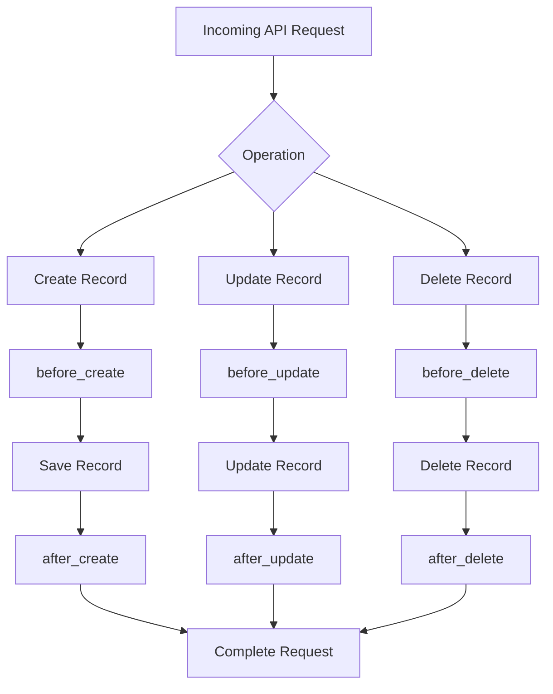

Lifecycle events allow you to execute custom backend logic at specific stages of a record's lifecycle.

Bludia provides hooks that can run before or after common database operations, allowing you to extend the default behavior of your backend without implementing separate API endpoints.

For example, you can validate incoming data before creating a record, send an email after an order is created, or perform additional operations when a record is updated.

## Understanding the Lifecycle

A record operation typically passes through different execution stages.

Bludia provides lifecycle events that allow your hooks to interact with these stages.

The main lifecycle events include:

- `before_create`
- `after_create`
- `before_update`
- `after_update`
- `before_delete`
- `after_delete`

Each event represents a specific point in a record operation.

## Lifecycle Overview

The following diagram illustrates how hooks fit into common record operations.

## Available Lifecycle Events

### Before Create

The `before_create` event executes before a new record is saved to its collection.

Use this event when you need to inspect, validate, or modify incoming data before it is stored.

Common use cases:

- Validate submitted information.
- Generate default values.
- Normalize incoming data.
- Apply additional business rules.
- Prepare data before persistence.

Example: When creating a customer, you can automatically normalize the email address before the record is saved.

### After Create

The `after_create` event executes after a new record has been created.

Use this event when you need to perform additional operations following successful record creation.

Common use cases:

- Send confirmation emails.
- Notify administrators.
- Create related records.
- Trigger external integrations.
- Record business events.

Example: When a new order is created, you can trigger an email notification to the customer.

### Before Update

The `before_update` event executes before an existing record is updated.

Use this event when you need to inspect or modify changes before they are persisted.

Common use cases:

- Validate updated information.
- Prevent invalid state transitions.
- Normalize modified values.
- Enforce business rules.
- Compare incoming values with existing data.

Example: When updating an order, you can prevent a user from changing its status to an invalid state.

### After Update

The `after_update` event executes after an existing record has been updated.

Use this event when you need to react to changes that have already been saved.

Common use cases:

- Notify users about important changes.
- Synchronize external systems.
- Maintain activity logs.
- Trigger follow-up operations.
- Update related application data.

Example: When an order changes from `pending` to `completed`, you can trigger a notification to the customer.

### Before Delete

The `before_delete` event executes before an existing record is deleted.

Use this event when you need to perform checks or additional operations before deletion.

Common use cases:

- Prevent deletion under certain conditions.
- Validate deletion requirements.
- Check dependencies.
- Perform cleanup operations.
- Enforce business rules.

Example: Prevent deleting a customer who still has outstanding orders.

### After Delete

The `after_delete` event executes after a record has been deleted.

Use this event when you need to perform follow-up operations after deletion.

Common use cases:

- Clean up external resources.
- Notify other systems.
- Record deletion events.
- Remove associated application data where appropriate.
- Trigger additional workflows.

Example: When a customer is deleted, you can notify an external service to update its records.

## Choosing the Right Lifecycle Event

Different events serve different purposes.

| Requirement | Recommended Event |
| --- | --- |
| Validate incoming data | `before_create` |
| Generate default values | `before_create` |
| Send a creation notification | `after_create` |
| Validate updated data | `before_update` |
| Prevent invalid state changes | `before_update` |
| React to updated records | `after_update` |
| Prevent record deletion | `before_delete` |
| Perform post-deletion operations | `after_delete` |

## Lifecycle Events and Business Logic

Lifecycle hooks are useful when business logic needs to run automatically as part of normal record operations.

Consider an order management application.

When an order is created:

1. The `before_create` hook validates the submitted order information.
2. Bludia saves the order.
3. The `after_create` hook triggers the required notification.

When the order is completed:

1. The `before_update` hook validates the requested status change.
2. Bludia updates the order.
3. The `after_update` hook triggers the completion workflow.

This allows business logic to remain associated with backend operations instead of being duplicated across different frontend applications.

## Best Practices

**Use Before Events for Validation**

Perform checks and data preparation before records are persisted.

**Use After Events for Follow-up Operations**

Use after events for operations that depend on a successful database change.

**Keep Hooks Focused**

Each hook should perform a clearly defined responsibility. Avoid putting unrelated business logic into a single hook.

**Handle Errors Carefully**

Unexpected failures should be handled appropriately so that hook execution does not create inconsistent application behavior.

**Avoid Unnecessary Operations**

Keep frequently executed hooks efficient, particularly when they run during high-volume record operations.

**Consider External Integrations**

When calling external services, account for network failures, response times, and retry behavior.

## Related Documentation

<CardGroup cols={2}>
  <Card title="Hooks Overview" icon="workflow" href="/hooks/overview">
    Understand how hooks extend Bludia's backend behavior.
  </Card>

  <Card title="Custom Code" icon="code" href="/hooks/custom-code">
    Learn how to implement custom backend logic.
  </Card>

  <Card title="Runtime" icon="terminal" href="/hooks/runtime">
    Understand the hook execution environment.
  </Card>

  <Card title={"Logs & Errors"} icon="file-text" href="/hooks/logs">
    Monitor hook execution and troubleshoot failures.
  </Card>
</CardGroup>
