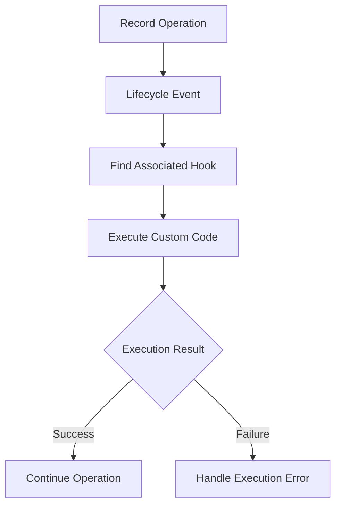

Custom Code allows you to extend Bludia's built-in backend functionality by writing your own logic inside hooks.

While Bludia provides built-in capabilities for managing data, authentication, and APIs, real-world applications often require additional business logic that is specific to their requirements.

With custom hooks, you can execute your own code during record lifecycle events and build workflows that go beyond standard database operations.

## Why Use Custom Code?

Custom code gives you greater control over how your backend behaves.

You can use it to:

- Validate and transform incoming data.
- Apply custom business rules.
- Generate values automatically.
- Trigger notifications and emails.
- Communicate with external APIs.
- Automate operations between collections.
- Execute application-specific workflows.

For example, an order management application might use custom code to calculate order totals, notify administrators, and synchronize order information with an external system.

## How Custom Code Works

Custom code is associated with a hook and its corresponding lifecycle event.

When the associated event occurs, Bludia executes the configured code within its hook runtime.

A typical execution flow looks like this:

The exact execution behavior depends on the lifecycle event and hook configuration.

## Common Use Cases

### Data Validation

Apply additional validation rules before data is stored.

Examples:

- Validate business-specific requirements.
- Check whether a submitted value is allowed.
- Prevent invalid state transitions.
- Normalize user-submitted information.

### Data Transformation

Modify or prepare data before it is processed.

Examples:

- Normalize phone numbers.
- Format submitted values.
- Generate reference numbers.
- Populate default values.

### Notifications and Emails

Trigger notifications when specific application events occur.

Examples:

- Notify administrators when a new customer registers.
- Send order confirmation emails.
- Notify customers when their booking is approved.
- Alert staff when a payment is overdue.

### External API Integrations

Connect Bludia with external services and systems.

Examples:

- Synchronize customer information.
- Send order information to another platform.
- Connect to third-party services.
- Trigger external automation workflows.

### Business Automation

Automate operations that would otherwise require manual intervention.

Examples:

- Create related records automatically.
- Update application data based on business rules.
- Trigger follow-up actions.
- Maintain additional business information.

## Custom Code and Lifecycle Events

Custom code runs in the context of the lifecycle event associated with its hook.

Choose the appropriate event depending on what your logic needs to accomplish.

| Event | Typical Custom Code Usage |
| --- | --- |
| `before_create` | Validate or transform incoming data |
| `after_create` | Trigger notifications or follow-up operations |
| `before_update` | Validate changes or enforce business rules |
| `after_update` | React to changes and synchronize data |
| `before_delete` | Check deletion requirements |
| `after_delete` | Perform post-deletion operations |

See [Lifecycle Events](/hooks/lifecycle) for a detailed explanation of each event.

## Execution Environment

Bludia executes custom hook code through its dedicated runtime rather than requiring developers to maintain a separate backend service for every custom operation.

This provides a controlled environment for executing application-specific backend logic.

When writing custom code, consider the following:

- Keep execution logic focused and efficient.
- Avoid unnecessary external requests.
- Handle unexpected errors appropriately.
- Consider execution time when communicating with external services.
- Avoid exposing sensitive credentials.
- Ensure your code handles missing or unexpected data.

See [Runtime](/hooks/runtime) for more information about the execution environment.

## Error Handling

Custom code should account for unexpected conditions that may occur during execution.

Common examples include:

- Missing input data.
- Invalid values.
- External API failures.
- Network timeouts.
- Unexpected runtime errors.

Implement appropriate error handling and use Bludia's hook logs to investigate execution failures.

See [Logs & Errors](/hooks/logs) for more information.

## Best Practices

**Keep Hooks Focused**

Each hook should have a clear responsibility. Avoid combining unrelated business operations into a single large script.

**Validate Input Data**

Never assume that incoming data is always valid or complete.

**Protect Sensitive Information**

Do not hardcode API credentials, passwords, or other sensitive information into custom code.

**Optimize Execution Time**

Avoid unnecessary computations and long-running operations.

**Handle External Dependencies**

External services can become unavailable. Account for failed requests and unexpected responses.

**Test Before Production**

Test custom code with different input values and edge cases before relying on it in production applications.

## Related Documentation

<CardGroup cols={2}>
  <Card title="Hooks Overview" icon="workflow" href="/hooks/overview">
    Understand how hooks extend Bludia.
  </Card>

  <Card title="Lifecycle Events" icon="git-branch" href="/hooks/lifecycle">
    Learn when custom code is executed.
  </Card>

  <Card title="Runtime" icon="terminal" href="/hooks/runtime">
    Understand the hook execution environment.
  </Card>

  <Card title={"Logs & Errors"} icon="file-text" href="/hooks/logs">
    Monitor execution and troubleshoot failures.
  </Card>
</CardGroup>
