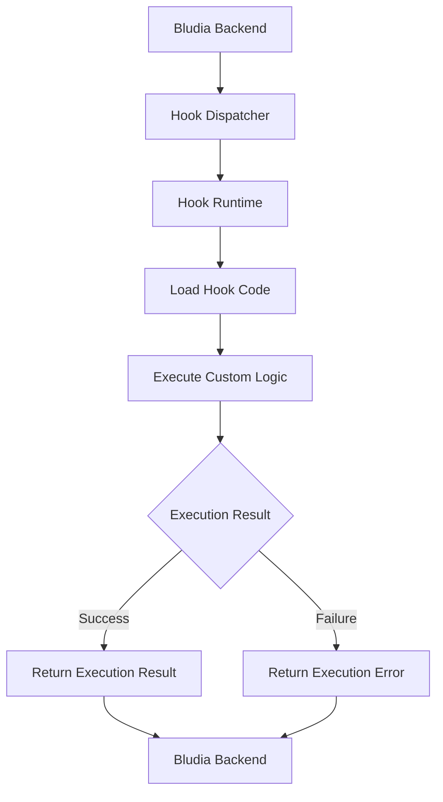

# Hook Runtime

Bludia executes custom hook code through a dedicated runtime environment designed to run application-specific backend logic safely and efficiently.

Instead of requiring developers to deploy and maintain separate backend services for every custom operation, Bludia provides a centralized execution environment that processes hook code when the associated lifecycle events occur.

The Hook Runtime acts as the execution layer between Bludia's backend and your custom logic.

## How the Runtime Works

When a lifecycle event triggers a hook, Bludia dispatches the associated custom code to the Hook Runtime for execution.

A typical execution flow looks like this:

The runtime is responsible for executing the custom code and returning its result to Bludia.

The exact behavior depends on the lifecycle event, hook configuration, and execution requirements.

## Runtime Architecture

Bludia uses a dedicated execution architecture to separate custom application logic from its primary backend operations.

This separation provides several benefits:

- **Isolation:** Custom code executes outside the main application request-handling process.
- **Separation of concerns:** Hook execution is handled independently from core backend functionality.
- **Extensibility:** Application-specific logic can be added without modifying Bludia's core backend.
- **Maintainability:** Runtime functionality can evolve independently of the main application.
- **Centralized execution:** Multiple projects can use the same runtime infrastructure.

This architecture also makes it easier to introduce additional runtime capabilities without requiring changes to existing project configurations.

## Execution Lifecycle

Every hook execution follows a series of steps.

### 1. Event Dispatching

When a supported operation occurs, Bludia identifies the lifecycle event and finds the hooks associated with it.

For example, creating a customer record may trigger a `before_create` or `after_create` hook.

### 2. Code Preparation

Bludia prepares the execution request and provides the runtime with the information required to execute the hook.

This may include:

- Hook configuration.
- Lifecycle event information.
- Relevant record data.
- Project context.
- Execution parameters.

### 3. Code Execution

The runtime loads the associated custom code and executes it within its execution environment.

The custom code performs the configured operations, such as validating data, transforming values, or triggering application workflows.

### 4. Result Handling

After execution, the runtime returns an execution result to Bludia.

Depending on the hook event and its configuration, Bludia processes the result or handles the execution failure accordingly.

### 5. Logging

Execution information and errors can be recorded for debugging and monitoring.

See Logs & Errors for more information.

## Execution Context

Custom code executes with a context provided by Bludia.

The context allows hooks to access information related to the operation that triggered them.

Depending on the lifecycle event, the available context may include:

| Context | Description |
| --- | --- |
| Project | Information about the project associated with the execution. |
| Collection | The collection involved in the operation. |
| Record | The record being created, updated, or deleted. |
| Event | The lifecycle event that triggered execution. |
| Input Data | Data provided by the associated operation. |
| Hook | Information about the executing hook. |

The available context depends on the event and execution configuration.

Always account for missing or optional values when writing custom code.

## Execution Isolation

The Hook Runtime is separated from Bludia's primary backend application.

This separation helps prevent custom application logic from becoming tightly coupled to core backend functionality.

However, developers should still write custom code carefully.

Consider the following:

- Avoid unnecessary resource-intensive operations.
- Do not assume external services are always available.
- Handle unexpected input and execution errors.
- Avoid relying on shared mutable state between executions.
- Keep custom logic independent whenever possible.
- Do not expose sensitive information through execution logs.

Runtime isolation is an architectural boundary, not a replacement for application-level security practices.

## Execution Performance

Hook execution adds additional processing to the operation that triggers it.

For this reason, custom code should be designed with execution performance in mind.

**Keep Operations Lightweight**

Perform only the operations necessary for the current hook.

**Avoid Unnecessary Network Requests**

External API requests can introduce additional latency and failure points.

**Use Appropriate Lifecycle Events**

For example, use `before_create` when validation must happen before a record is stored, and `after_create` when the operation should trigger a follow-up action.

**Avoid Large Processing Tasks**

Do not perform expensive computations or process large datasets inside hooks unless the execution environment explicitly supports the required workload.

**Handle Timeouts**

External requests and other potentially slow operations should have appropriate timeout handling.

## Runtime Errors

Runtime errors can occur when custom code encounters unexpected conditions or cannot complete its execution.

Common causes include:

- Syntax errors.
- Invalid input data.
- Missing execution context.
- Unexpected runtime exceptions.
- External API failures.
- Network connectivity issues.
- Execution timeouts.

When an execution fails, Bludia can record the available error information to help identify the cause.

Use the hook execution logs to investigate failures and verify that your custom code behaves as expected.

See Logs & Errors for troubleshooting guidance.

## Security Considerations

Custom code executes as part of your application's backend workflows. It should therefore be treated as trusted application logic.

Follow these security practices:

**Protect Credentials**

Never hardcode API keys, passwords, or private tokens into custom code.

**Validate All Input**

Treat incoming data as untrusted, even when it originates from your own frontend.

**Limit External Access**

Only communicate with external services required by your application.

**Avoid Exposing Internal Information**

Do not return database credentials, private configuration, or sensitive execution details to frontend clients.

**Review Custom Logic**

Test and review custom code before enabling it in production.

## Best Practices

- Keep individual hooks focused on a single responsibility.
- Prefer simple execution logic over complicated workflows.
- Use lifecycle events that match the intended operation.
- Handle exceptions and unexpected values.
- Minimize unnecessary external dependencies.
- Test hooks with different input scenarios.
- Monitor execution logs after deploying changes.
- Avoid making assumptions about execution order unless explicitly guaranteed.

## Related Documentation

<CardGroup cols={2}>
  <Card title="Hooks Overview" icon="workflow" href="/hooks/overview">
    Understand how hooks extend Bludia's backend.
  </Card>

  <Card title="Lifecycle Events" icon="git-branch" href="/hooks/lifecycle">
    Learn how lifecycle events trigger hook execution.
  </Card>

  <Card title="Custom Code" icon="code" href="/hooks/custom-code">
    Learn how to write application-specific backend logic.
  </Card>

  <Card title={"Logs & Errors"} icon="file-text" href="/hooks/logs">
    Monitor executions and troubleshoot runtime failures.
  </Card>
</CardGroup>
